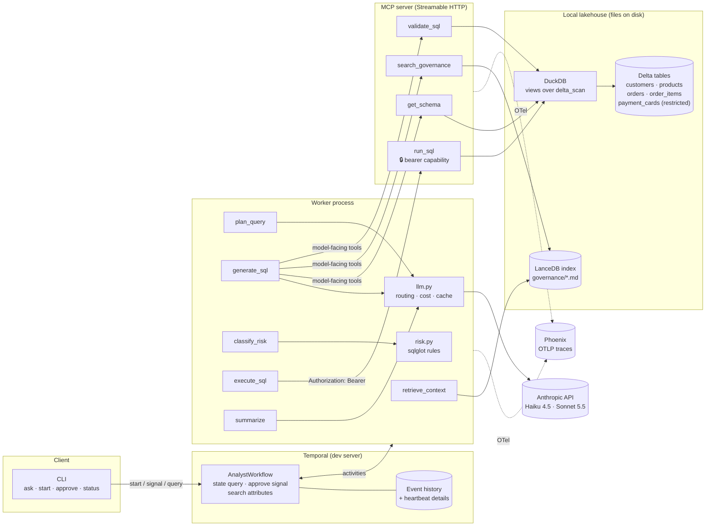
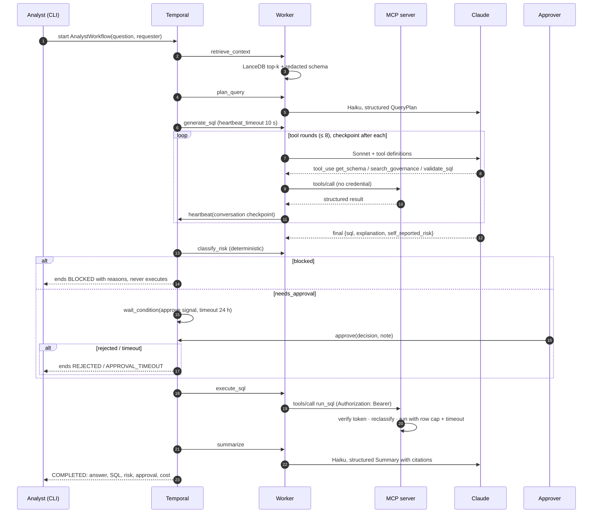
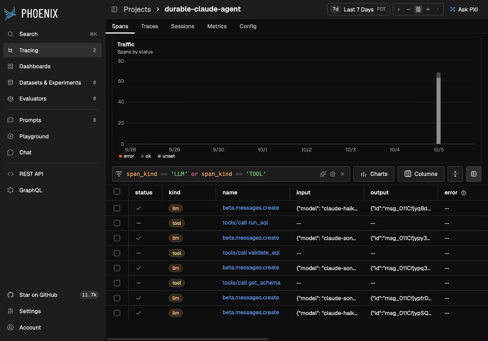

# Architecture

**Author:** Carlos Morillo · **Status:** working prototype, all milestones complete

A Claude-powered text-to-SQL analyst over a governed lakehouse, run as a Temporal workflow.
This document covers the components and why each one is there, the sequence of one run, the
failure modes and the exact mechanism that handles each, the security model for tool
authorization, and observability. Each design decision, with the alternatives considered, is a
one-paragraph ADR in [`docs/adr/`](adr/README.md).

## Components

| Component | Module | Notes |
|---|---|---|
| Workflow | `workflows.py` | Deterministic orchestration only. Imports models and Temporal; nothing else. |
| Activities | `activities.py` | One per step. Idempotent; `generate_sql` is resumable via heartbeat checkpoints. |
| LLM wrapper | `llm.py` | Model routing, structured outputs, refusal fallbacks, price table, request-hash response cache, OTel span per call. |
| Risk classifier | `risk.py` | Pure Python + sqlglot. Loads the rule lists from the TOML block in `governance/policies.md`. |
| MCP server | `mcp_server/` | Four tools; `run_sql` requires a capability header and reclassifies before executing. |
| Lakehouse | `lakehouse.py`, `seed.py` | DuckDB over Delta; redacted schema descriptions; bounded, interruptible execution. |
| Retrieval | `retrieval/` | Heading-scoped chunks, local MiniLM embeddings, LanceDB. |
| Observability | `observability.py` | OTel SDK + OpenInference instrumentors + Temporal tracing interceptor, exported to Phoenix. |
| Evals | `evals/` | Runs the real workflow on a private dev server; five scorers; scorecard. |

## Why each component

The system has four jobs: survive crashes and long waits without losing work, never execute
SQL that policy forbids, write SQL that follows the organization's own definitions, and stay
measurable and cheap enough to iterate on. Each component exists for one of them.

**Temporal: durable orchestration ([ADR-001](adr/001-temporal-for-orchestration.md)).** An agent
step is a slow, failure-prone remote call whose result must not be lost and whose retry must not
duplicate side effects. Temporal gives each step a timeout, a retry policy, a heartbeat, and a
durable record, and it gives the whole run a replayable history and a place to wait for a human
for hours without a process holding memory. A Python loop with retries, a framework
checkpointer, or a queue plus a state table would each rebuild part of this by hand, inside the
process that can crash. The SQL tool loop checkpoints itself in heartbeat details, so a retry
resumes mid-conversation ([ADR-007](adr/007-heartbeat-checkpointing.md)). The repo uses one
workflow, one task queue, and no Temporal feature beyond what the story needs.

**MCP server over Streamable HTTP: the tool boundary
([ADR-002](adr/002-mcp-over-http-with-capability-token.md)).** The tools are the agent's only
path to data, so they are a service with a protocol, not functions bound to one process. MCP
gives a typed tool catalog, structured results, and an ecosystem of clients (including the MCP
Inspector) that can call the same server. The HTTP transport carries request headers, which
makes the authorization boundary real: the credential for `run_sql` travels in a header the
model never sees, which stdio could not do.

**Claude, routed by step ([ADR-006](adr/006-model-routing.md),
[ADR-009](adr/009-manual-tool-loop.md)).** Haiku 4.5 handles the two structured
transformations over supplied context (`plan_query`, `summarize`); Sonnet 5.5 handles SQL
generation with tools, where mistakes are expensive. That costs about a third of using the
strong model everywhere, and the routing is one environment variable. The tool loop is a short
manual loop on the Messages API rather than the SDK tool runner, because it must checkpoint
after every round and resume from an arbitrary point.

**sqlglot risk classifier: the only gate signal
([ADR-004](adr/004-deterministic-risk-classifier.md)).** Whether SQL may run is decided by
parsing it, not by asking the model. The AST, resolved against the live schema, shows exactly
which tables and columns a query touches however it is written (CTEs, `SELECT *`, table
functions such as `read_csv`), which keyword filters miss. The rules live as a TOML block in
`governance/policies.md` and are unit-tested exhaustively. The same classifier runs three times:
inside `validate_sql`, so the model sees the verdict and can fix its SQL; in `classify_risk`,
whose verdict alone decides the approval gate; and again inside `run_sql`.

**Delta Lake tables read by DuckDB: the lakehouse
([ADR-005](adr/005-duckdb-delta-local-lakehouse.md)).** Delta is the table format an enterprise
actually has; DuckDB reads Delta tables as views in milliseconds on a laptop, with no cluster.
DuckDB also supplies what the tools need: `information_schema` for `get_schema`, `EXPLAIN` for
the dry run in `validate_sql`, and `interrupt()` for the statement timeout. SQLite tells no
lakehouse story, and local Spark or Trino cost minutes of JVM start-up. Moving to Unity Catalog,
Iceberg, or Snowflake changes `lakehouse.py` and nothing above it.

**LanceDB with local MiniLM embeddings: governance retrieval
([ADR-003](adr/003-lancedb-for-retrieval.md)).** Correct SQL depends on documents, not just on
the schema: the data dictionary defines net revenue (cancelled orders excluded, discounts and
refunds subtracted), and the policies say which columns are PII and which table is restricted.
`retrieve_context` and the `search_governance` tool fetch the relevant sections so Claude
follows those definitions and cites them in its answer. LanceDB is embedded and Arrow-native:
a directory next to the Delta tables, no server process. `all-MiniLM-L6-v2` runs on CPU, so
building and querying the index costs zero tokens. Chunks keep their heading path, the same
identifier the risk classifier cites. Putting both documents in the prompt would work at
today's 22 chunks, but would not scale to a real governance library and would make the eval's
retrieval-recall metric meaningless; a hosted vector database would add a cloud dependency.

**Response cache: idempotent retries, cheap evals ([ADR-008](adr/008-response-cache.md)).**
Temporal guarantees a completed activity is never re-run, but it cannot make the API calls
inside an interrupted activity idempotent. `llm.py` hashes each request and stores the response
in SQLite, so a retried call and a re-run eval cost nothing and return the same answer. Cache
hits are recorded on the trace and in the usage ledger; `LLM_CACHE=false` turns it off, and the
crash demo always runs with it off.

**OpenTelemetry and Phoenix: one trace per run
([ADR-012](adr/012-opentelemetry-phoenix.md)).** One question crosses the CLI, the Temporal
server, the worker, Claude, and the MCP server. OpenTelemetry stitches those into a single
trace, OpenInference instrumentors give the Claude and MCP calls LLM-aware spans (model,
tokens, tool calls), and Phoenix renders them locally with no account. Changing backend means
changing the OTLP endpoint.

**Around the system.** Evals run the real workflow on a private Temporal dev server, so the
approval metric is read from what Temporal actually scheduled
([ADR-010](adr/010-evals-through-the-workflow.md)). `detect-secrets` runs in pre-commit and CI
([ADR-011](adr/011-secrets-scanning.md)). `make quickstart-smoke` runs the README Quickstart's
commands in CI on every change (services in the background, zero tokens), and Docker Compose runs
Temporal and Phoenix locally.

## Sequence of one run

Stage transitions are upserted into the `AnalystStage` search attribute at every step, so the
CLI, the eval harness, and the crash demo can read progress from the server without a worker.

## Failure modes

| Failure | What happens | Mechanism |
|---|---|---|
| Claude call times out or returns 5xx / 429 | The SDK retries twice with backoff; if the activity still fails, Temporal retries it (up to 4 attempts, 2 s → 30 s backoff). Completed earlier steps are not re-run. | Anthropic SDK `max_retries`; activity `RetryPolicy`; `start_to_close_timeout` |
| Claude refuses (safety) or request is malformed | Activity fails immediately and the workflow ends `FAILED` with the reason. No retry: it will not get better. | `non_retryable_error_types` includes `LLMRefusalError`, `BadRequestError`, `AuthenticationError` |
| MCP tool error (bad SQL in `validate_sql`, DuckDB error) | Returned to the model as an `is_error` tool result so it can fix the SQL; not an activity failure. | `ToolError` → `tool_result` with `is_error` |
| MCP server unreachable | The activity fails and is retried (3 attempts); `generate_sql` resumes from its checkpoint. | `TOOL_RETRY`, heartbeat details |
| Worker crash mid `generate_sql` | Heartbeats stop; after 10 s the server times the attempt out and schedules a retry; any worker on the queue picks it up and resumes from the last checkpoint. Demo: `make demo-crash`. | `heartbeat_timeout`, `activity.heartbeat(details)`, `info().heartbeat_details` |
| Worker crash between activities | Nothing is lost: history holds every completed result. A new worker replays and continues. | Event sourcing / replay |
| Long Claude turn under load | The 3 s heartbeat pulse keeps the attempt alive during a single long call. | background `pulse()` task |
| Approval never arrives | `wait_condition` times out (24 h default); workflow ends `APPROVAL_TIMEOUT`; nothing executed. | `workflow.wait_condition(timeout=...)` |
| Approver rejects | Workflow ends `REJECTED` with the note; nothing executed. | signal handler, first decision wins |
| Policy violation in generated SQL | `classify_risk` returns `blocked`; workflow ends `BLOCKED`; `execute_sql` is never scheduled. Checked by the eval's approval metric from event history. | deterministic classifier before the gate |
| Model tries to call `run_sql` | Not in its tool list; and the server refuses without the bearer token. | filtered tool list + `ctx.headers` check |
| Caller with the token sends blocked SQL | `run_sql` reclassifies and refuses regardless of credentials. | defense in depth in the tool |
| Runaway query | Row cap (1000) via wrapped `LIMIT`, statement timeout via `interrupt()`, configuration locked. | `lakehouse.execute` |
| Duplicate API calls on retry | Identical requests served from the response cache; cache hits recorded on the span and in the usage ledger. | `ResponseCache` |

## Security model for tool authorization

Threat: the model, or a prompt injected through data, tries to execute SQL it should not.

1. **Least-privilege view.** `get_schema` omits restricted tables and redacts PII sample values,
   so the model does not learn what it must not touch.
2. **Model-facing tool list excludes `run_sql`.** The `generate_sql` activity filters the MCP
   catalog to `MODEL_TOOLS`. The model cannot call what it is not offered.
3. **Capability check at the tool.** `run_sql` compares `Authorization: Bearer <token>` against
   `RUN_SQL_CAPABILITY_TOKEN` with `hmac.compare_digest`. Only the worker's `execute_sql`
   activity holds the token; the model-facing session has no credential. Tested over real HTTP
   with no token, a wrong token, and the right token.
4. **Deterministic policy before the gate and again inside the tool.** `classify_risk` decides
   `safe` / `needs_approval` / `blocked` from the SQL AST and the live schema; `run_sql` repeats
   the check so a token holder still cannot read `payment_cards` or call `read_csv`.
5. **Read-only data layer.** DuckDB views over Delta cannot be written; configuration is locked;
   every query is wrapped with a row cap and interrupted at the timeout.
6. **Human in the loop for PII.** Approval is a Temporal signal recorded in history with the
   approver and note.

What this prototype does not do, and production must: authenticate the approver (today any
CLI caller can signal), scope tokens per requester and expire them, enforce grants in the
warehouse itself (Unity Catalog, Snowflake roles), and run the MCP server behind TLS with
mutual authentication.

## Observability

OpenTelemetry spans flow from the CLI (StartWorkflow), through the worker (RunActivity per
step, `llm.request` with cost and cache-hit attributes, instrumented LLM spans with token
counts), across the MCP client/server boundary (context propagated by the MCP instrumentor),
to the server's `tool.*` spans carrying the SQL and risk level. Phoenix renders one trace per
run. `make up` starts it (or `make phoenix` alongside `make temporal`); `OTEL_ENABLED=false`
turns tracing off. Why this stack: [ADR-012](adr/012-opentelemetry-phoenix.md).

