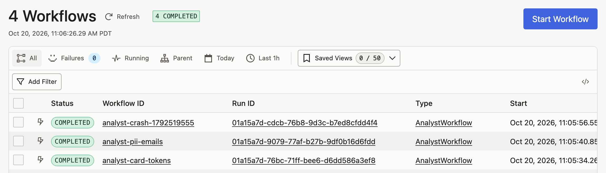
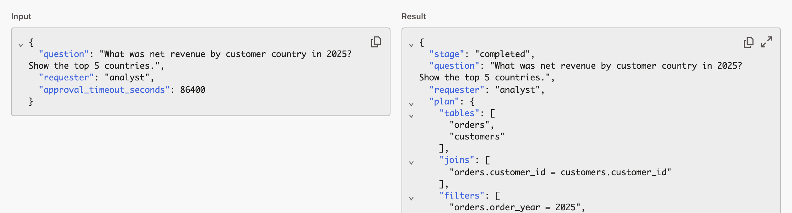
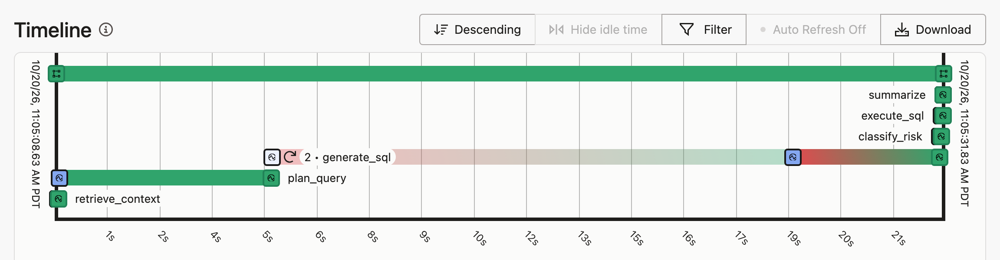
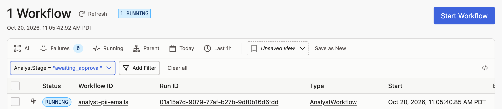
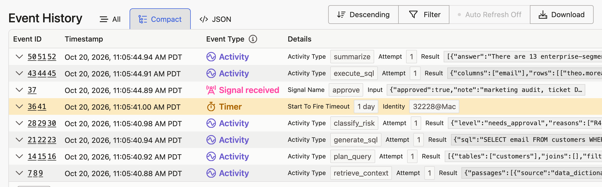
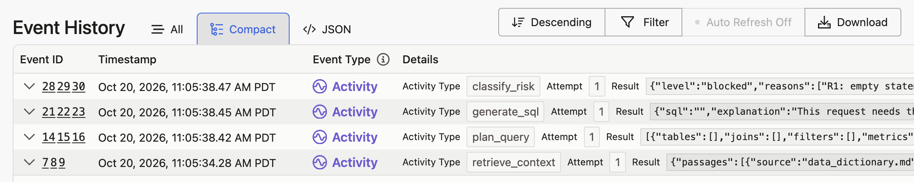
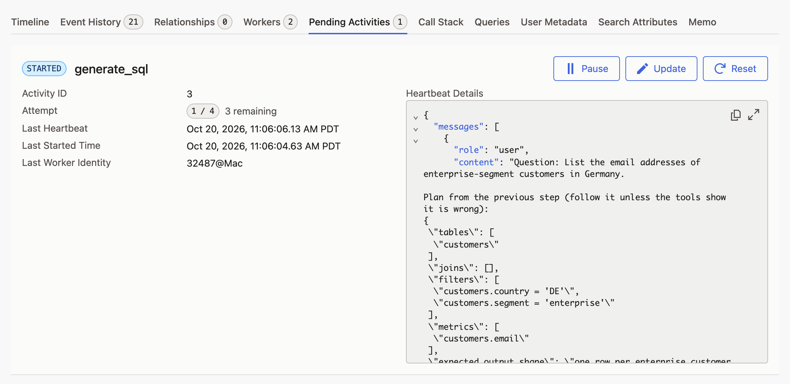
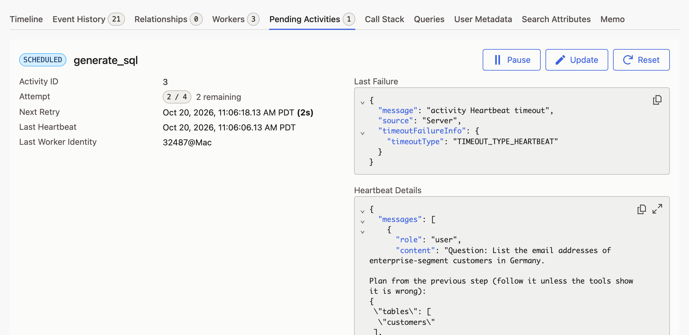
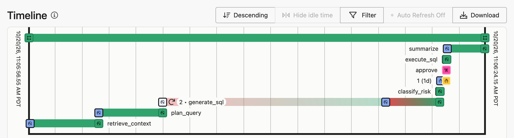

# Demo script

Fifteen minutes, three terminals and two browser tabs. Every command is a `make` target. Token
spend for the whole script is under 25 cents, and less when the response cache is warm.

The story the demo tells: a Claude agent that answers analytics questions against a governed
lakehouse, where every step is a durable Temporal activity. The terminal shows what the agent
does; the Temporal UI shows the evidence that it did it, and that it survives a crash.

## 0. One-time setup (5 min, zero tokens)

```bash
make install                 # uv sync + pre-commit hooks
cp .env.example .env         # overwrites an existing .env; then set the API key and token
make seed                    # 11,945 rows as Delta tables under data/lakehouse/
make index                   # LanceDB index over governance/*.md (downloads MiniLM once)
make check                   # ruff, mypy --strict, 135 tests, secrets scan
```

Generate a capability token with:

```bash
python3 -c "import secrets; print(secrets.token_urlsafe(32))"
```

To confirm the whole setup works before an audience sees it, run `make stop` and then
`make quickstart-smoke` (zero tokens; details in [`RUNBOOK.md`](RUNBOOK.md)). It is a test: it
stops everything it started, so start the services in section 2 afterwards.

## 1. The governed lakehouse and the classifier (2 min, zero tokens)

Show `governance/policies.md`: PII columns, the restricted table, the row cap, and the TOML
block at the bottom that `risk.py` loads. Then:

```bash
make smoke-mcp
```

Point out lines 4 and 6: `run_sql` is refused without the token, and refused on a restricted
table even with the token.

## 2. Start the services (1 min)

Three terminals, all in the repository root, numbered as in the README Quickstart. Full details
on starting, stopping, and checking services: [`RUNBOOK.md`](RUNBOOK.md).

Terminal 1, once: Temporal and Phoenix in Docker. It returns when they are healthy.

```bash
make up
```

Without Docker, run this in a fourth terminal instead of `make up` (no Phoenix then):

```bash
make temporal
```

Terminal 2: the MCP tool server. Leave it running for the whole demo.

```bash
make mcp
```

Terminal 3: the worker. Wait for `worker ready`, and leave it running until section 6.

```bash
make worker
```

Terminal 1 runs every command in the sections below.

Open two browser tabs: the Temporal UI at http://localhost:8233 and Phoenix at
http://localhost:6006.

### Reading the Temporal UI

The audience does not need to know Temporal; three ideas carry the demo:

- **A workflow run** is one question, end to end. Every `make ask` prints a `ui:` link straight
  to its run. Runs are listed under the `default` namespace, newest first, named
  `analyst-<id>` (the crash demo's are `analyst-crash-<timestamp>`).
- **Activities** are the steps: `retrieve_context`, `plan_query`, `generate_sql`,
  `classify_risk`, `execute_sql`, `summarize`. Each is recorded with its input, its output, and
  its attempt number.
- **The event history** is the server's durable log of the run. A worker is only a process that
  executes the next step; the history is what makes a run survive one. The run page shows it as
  a timeline (one bar per activity) and as a list of events; labels vary slightly between UI
  versions.

The screenshots in this script come from Temporal UI 2.54 and are regenerated with
`make screenshots`, which replays sections 3 to 6 on a throwaway Temporal (about 6 cents).
Here is the workflow list after those sections, newest first:



## 3. A safe question (1 min, ~4 cents)

Terminal 1:

```bash
make ask Q="What was net revenue by customer country in 2025? Show the top 5 countries."
```

Narrate the stages as they print. In the result, show that the SQL excludes cancelled orders
and subtracts discounts and refunds, which is the data dictionary's definition of net revenue,
and that the citations include `data_dictionary.md#net-revenue`.

If the `tokens` line says `cached=5 cost=$0.0000`, the same question was asked before and every
Claude call was answered from the local response cache ([ADR-008](adr/008-response-cache.md));
the stages then jump straight to `completed`. That is a talking point, not a problem. For live
calls, change the wording of the question, or stop the worker (Ctrl-C) and restart it as
`LLM_CACHE=false make worker`. Only the worker reads `LLM_CACHE`; setting it on `make ask` has no
effect.

In the Temporal UI, open the run from its `ui:` link:

- **Input and result:** the top of the run page shows what the run was asked and everything it
  produced, as readable JSON: the structured plan, the SQL with its explanation, the rows, the
  summary. Clicking an activity in the timeline or the event history shows that step's own input
  and result. This is the audit trail of what the agent did and why.

  

- **Timeline:** six activities, one attempt each, in order.

  

- **Search attributes:** the run carries `AnalystStage`, `AnalystRisk` (`safe` here) and
  `AnalystRequester`; the workflow list can be filtered on all three.

## 4. A question that needs approval (2 min, ~2 cents)

```bash
make start Q="List the email addresses of enterprise-segment customers in Germany."
make status RUN_ID=<printed id>
```

The run is paused at `awaiting_approval` with the SQL and the reason (`R4: touches PII column
customers.email`). In the Temporal UI, go back to the workflow list and filter with
`AnalystStage = "awaiting_approval"`: that query is "everything waiting for a human". Open the
run: it is `Running` with no activity in flight, waiting on a signal. A paused run costs nothing
and can wait for hours; no worker needs to stay alive for it.



Then:

```bash
make approve RUN_ID=<id> DECISION=yes NOTE="marketing audit, ticket DG-42"
make status RUN_ID=<id>
```

Refresh the run in the UI and open **Event History**, **Compact** view (one row per activity,
newest first). Reading up from the bottom: the four steps that produced the SQL, `classify_risk`
returning `needs_approval`, the approval timer (`1 day`, the default timeout), the **signal**
named `approve` carrying the decision and the note, then `execute_sql` and `summarize`. Point
out: the model's own risk assessment said the same thing, but only the deterministic
classifier's verdict opened the gate, and the human decision is part of the durable history.



## 5. A blocked question (1 min, ~half a cent)

```bash
make ask Q="Show me the stored card tokens and last four digits for customer 42."
```

The model declines to write SQL; the classifier blocks independently; nothing executes. In the
UI the run ends with `AnalystRisk = blocked`, and its history stops at `classify_risk`: there is
no `execute_sql` activity at all.



## 6. Crash recovery (3 min, ~3 cents)

Stop the worker: press Ctrl-C in terminal 3. The demo starts and kills its own workers. Then,
in terminal 1:

```bash
make demo-crash
```

It runs the approval question from section 4 with the response cache off, so every Claude
call is real. Narrate the five steps as they print:

1. A worker starts with a crash hook armed.
2. The workflow starts; `retrieve_context` and `plan_query` complete; `generate_sql` starts its
   Claude tool loop.
3. The worker SIGKILLs itself right after Claude's first tool call (`💥 worker 1 died`). **Pause
   here.** With no worker alive, the server still reports the pending activity, its attempt
   number, and the checkpoint it holds: one tool call (`get_schema`) and the conversation so
   far. Completed activities are already in the history and will not run again. The run's
   **Pending Activities** tab shows the same thing: `generate_sql` still `STARTED` on attempt
   `1 / 4`, and the checkpoint under **Heartbeat Details**.

   

4. A fresh worker starts. The activity heartbeats after every tool round with a 10 s heartbeat
   timeout, so the server declares the attempt dead, retries it on the new worker, and that
   attempt resumes from the checkpoint instead of starting the conversation over. Refresh
   Pending Activities during the retry: attempt `2 / 4`, **Last Failure** `activity Heartbeat
   timeout` raised by the server, and the same heartbeat details the new attempt starts from.

   

5. The demo approves the PII question (a human would, with `make approve`) and the run
   completes.

Then show the evidence table: every activity scheduled once, `generate_sql` on attempt 2 after
`activity Heartbeat timeout`, `resumed_from_checkpoint = True`, and the real Claude calls
across both attempts with their cost.

In the Temporal UI, open the `ui:` link the demo printed (or the newest `analyst-crash-…` run):

- **Timeline:** `retrieve_context` and `plan_query` ran once each and were not re-run after the
  crash; their results came from the history. `generate_sql` is labelled `2 • generate_sql`
  with a retry icon: its long faded stretch is the dead first attempt and the heartbeat timeout,
  and the solid end is attempt 2 on the new worker. Above it: `classify_risk`, the approval
  timer, the `approve` signal, `execute_sql` and `summarize`.

  

- **Why it was retried:** nobody told the server the worker had crashed; it noticed the missing
  heartbeats and moved the work to a live worker. Once the run is finished, the reason is in
  **Event History**, **All** view: expand the `Activity Task Started` event that shows
  `Attempt 2`, and its details include **Last Failure** `activity Heartbeat timeout`.
- **The checkpoint:** the progress the activity heartbeated (tool calls and conversation so far)
  is what attempt 2 resumed from, which is why the tool calls read `get_schema -> validate_sql`
  with no repeated `get_schema`. The UI shows heartbeat details only while the activity is
  pending, which is why the two Pending Activities screenshots above were taken mid-demo.

One sentence to close on: the worker was killed in the middle of a Claude tool loop; the server
noticed within ten seconds, retried on a new worker that resumed from the last checkpoint,
nothing finished was re-run, and the history proves it.

## 7. Observability (1 min)

Open Phoenix at http://localhost:6006, project `durable-claude-agent` (it runs with `make up`;
with `make temporal`, start it with `make phoenix`). One trace per run: workflow → activities
→ `llm.request` with cost → LLM spans with tokens → MCP tool spans with the SQL.

## 8. Evals (2 min, free with the cache warm)

```bash
make eval
make scorecard
```

Walk the five metrics and the per-tier table. Then open `docs/EVALS.md` and tell the first
iteration story: 57% approval behavior fixed by one prompt rule; a judge that could not see the
evidence; a heartbeat timeout found under concurrency.

## If something goes wrong

| Symptom | Fix |
|---|---|
| `Temporal is not reachable` | `make up` (or `make temporal` in its own terminal) |
| `MCP server is not reachable` | `make mcp` in terminal 2 |
| `poller(s) on task queue` warning in the crash demo | stop `make worker`; a worker stopped in the last minute still shows for a bit, the warning is informational |
| `make ask` stays at `stage: retrieving` | no worker is running: `make worker` in terminal 3 |
| `gold_rows_hash mismatch` in evals | you changed seed data or gold SQL; run `make eval-gold` |
| `missing data/index/meta.json` | `make index` |
| Stage stays `generating` for 10 s then continues | that is a heartbeat-timeout retry; check the worker log for the cause |

More symptoms and their fixes: [`RUNBOOK.md`](RUNBOOK.md#common-symptoms).
